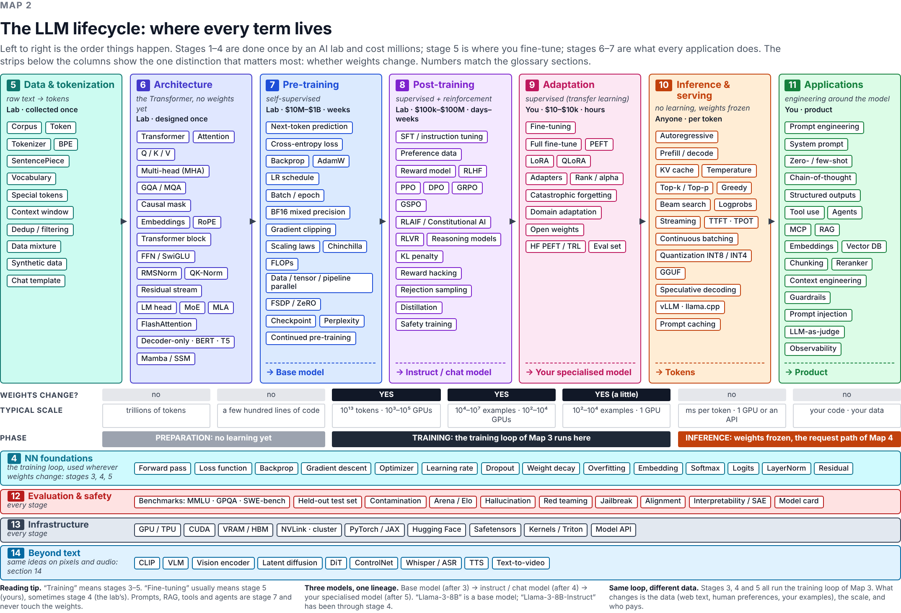

# The AI landscape field guide

**About 340 AI and machine-learning terms — from classic ML to LLM agents — explained in plain language and placed on a map of where they sit: pre-training, post-training, fine-tuning, inference, applications.**

📖 **Read it online:** https://waso.github.io/ai-landscape-guide/

Made for people who learn from videos and courses and keep meeting new acronyms. Every entry has a short definition and a **why it matters** line; seven maps show how the pieces fit together.



## What is inside

| | |
|---|---|
| **Seven maps** | the nested circles of AI; the LLM lifecycle (seven stages, every term placed, “do the weights change?”); the training loop; the life of one API request; inside a Transformer block with real numbers; RAG and the agent loop with MCP; a decision guide (prompt → RAG → fine-tune → train) |
| **Glossary, 14 sections** | ordered like the lifecycle: big picture · learning paradigms · classic ML · neural-network foundations · data & tokenization · the Transformer · pre-training · post-training & alignment · adapting a model · inference & serving · building applications · evaluation & safety · infrastructure · beyond text |
| **Reference pages** | a software engineer’s translation table · orders of magnitude · math-notation decoder · model families and how to read a model name · a chapter map for Raschka’s *Build a Large Language Model (From Scratch)* |
| **Guides** | the 35 acronyms of the Stanford CME295 lecture-1 slide, decoded in plain words |
| **A–Z index** | ~660 entries including nicknames and acronyms, each linking to its explanation |

## Contributing

Corrections, clearer wording and missing terms are all welcome — this is meant to be a community document. The glossary is plain Markdown, one file per section, one entry per term, so a contribution is usually a small pull request. See **[CONTRIBUTING.md](CONTRIBUTING.md)** for the entry format, the style rules and the fact-checking expectations, and use the issue templates for a *new term* or a *correction*.

Quick local preview:

```bash
pip install -r requirements.txt
python scripts/build_index.py      # regenerates docs/index-a-z.md from the glossary files
python scripts/check.py            # validates every entry
mkdocs serve                       # http://127.0.0.1:8000
```

The site is built and published to GitHub Pages automatically by [`.github/workflows/deploy.yml`](.github/workflows/deploy.yml) on every push to `main`.

## Accuracy

Every factual claim (dates, numbers, who uses what) was checked against primary sources before publication, and the pages that go stale fastest (orders of magnitude, model families) say so at the top. If you find something wrong, please open a correction issue with a source.

## Credits and licence

Created and maintained by Waldemar Sojka. The initial content was drafted with the help of Claude (Anthropic) and then fact-checked against primary sources; all remaining errors are the maintainer’s.

- Text, maps and diagrams: [Creative Commons Attribution 4.0](https://creativecommons.org/licenses/by/4.0/) (CC BY 4.0) — reuse freely with attribution.
- Scripts and site configuration: [MIT](LICENSE).
