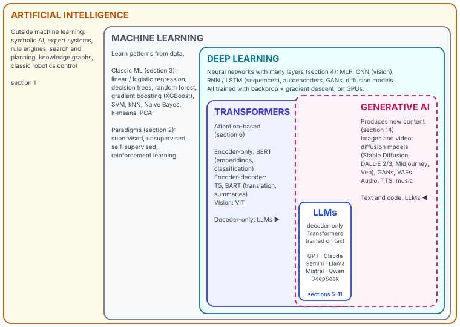

# Map 1 — The big picture

*Where AI, machine learning, deep learning and LLMs sit.*

Each box is inside the one around it. LLMs sit in the overlap of two ideas: they are Transformers (an architecture) and they are generative (what they do). Everything in the [LLM lifecycle](lifecycle.md) lives inside that small blue box.

## The four ways a model can learn

Every training technique in the glossary is one of these four in disguise.

| | Learns from | Typical tasks | Classic algorithms | In the LLM lifecycle |
|---|---|---|---|---|
| **Supervised** | Examples with the right answer attached (labels) | Classification, regression | Linear / logistic regression, trees, boosting, SVM, kNN, CNNs on labelled images | SFT / instruction tuning · reward-model training · your LoRA fine-tune · embedding models |
| **Unsupervised** | Raw data, no answers | Clustering, dimensionality reduction, anomaly detection | k-means, PCA, t-SNE / UMAP, autoencoders | Mostly indirect: visualising embeddings, clustering documents for RAG, topic discovery |
| **Self-supervised** | Raw data, with the label generated from the data itself | Next-token prediction, masked prediction, contrastive learning | GPT-style causal LM, BERT-style MLM, CLIP, word2vec | Pre-training (the whole base model) · continued pre-training |
| **Reinforcement** | Trial and error with a reward signal | Games, robotics, control, decision making | Q-learning, DQN, MCTS / AlphaGo, PPO, GRPO | RLHF · RLAIF · RLVR for reasoning models · DPO is the shortcut that skips RL |

See [section 2 — Learning paradigms](../glossary/02-learning-paradigms.md).
