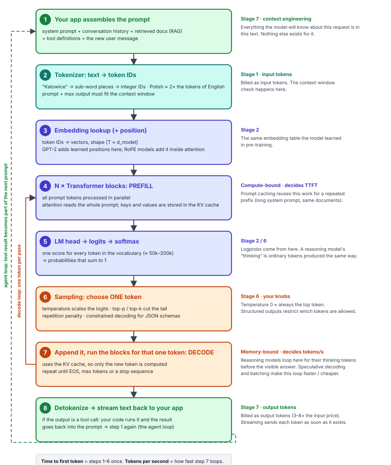

# Map 4 — Life of a request

*What happens when you call a model.*

One API call, from your code to the model and back. Steps 3–5 are the Transformer itself ([Map 5](transformer-block.md)); everything else is tokenization, sampling and plumbing. No weights change anywhere on this page.

## The steps in words

1. **Your app assembles the prompt** — system prompt + conversation history + retrieved docs (RAG) + tool definitions + the new user message. Everything the model will know about this request is in this text; nothing else exists for it. *(Stage 7 — context engineering)*
2. **Tokenizer: text → token IDs** — "Katowice" → sub-word pieces → integer IDs. Polish costs about 2× the tokens of English. The prompt plus the maximum output must fit the context window. Billed as input tokens. *(Stage 1)*
3. **Embedding lookup (+ position)** — token IDs → vectors of shape [T × d_model]. GPT-2 adds learned positions here; RoPE models add position inside each attention layer. *(Stage 2)*
4. **N × Transformer blocks: PREFILL** — all prompt tokens are processed in parallel; attention reads the whole prompt and the keys and values are stored in the KV cache. Compute-bound; decides time-to-first-token. Prompt caching reuses this work for a repeated prefix.
5. **LM head → logits → softmax** — one score for every token in the vocabulary (≈ 50k–200k) → probabilities that sum to 1. Logprobs come from here. A reasoning model's "thinking" is ordinary tokens produced the same way.
6. **Sampling: choose ONE token** — temperature scales the logits; top-p / top-k cut the tail; repetition penalty; constrained decoding for JSON schemas. Temperature 0 ≈ always the top token. *(Stage 6 — your knobs)*
7. **Append it, run the blocks for that one token: DECODE** — uses the KV cache, so only the new token is computed; repeat until EOS, max tokens or a stop sequence. Memory-bound; decides tokens per second. Reasoning models loop here for their thinking tokens before the visible answer. Speculative decoding and batching make this loop faster and cheaper.
8. **Detokenize → stream text back to your app** — if the output is a tool call, your code runs it and the result goes back into the prompt → step 1 again (the agent loop). Billed as output tokens (3–8× the input price). *(Stage 7)*

**Time to first token** = steps 1–6 once. **Tokens per second** = how fast step 7 loops.
