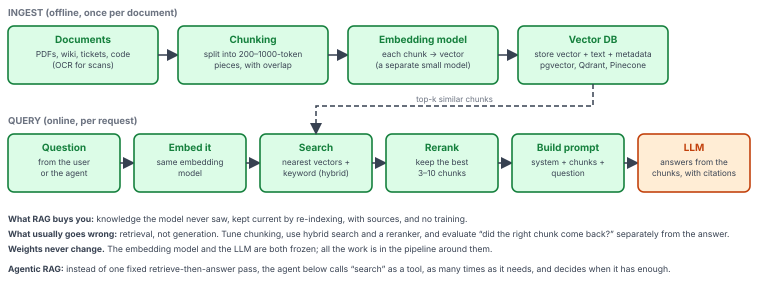
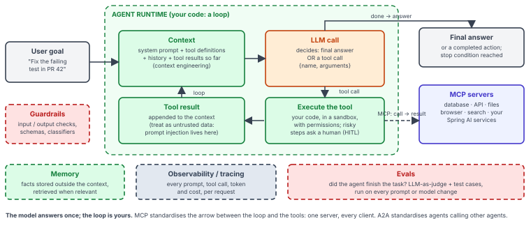

# Map 6 — RAG and the agent loop

*Around the model.*

Stage 7 in two pictures. Both use a frozen model; the engineering is in the pipeline. RAG gives the model your knowledge; the agent loop gives it hands. MCP is the plug between the loop and the tools.

## Retrieval-Augmented Generation

- **What RAG buys you:** knowledge the model never saw, kept current by re-indexing, with sources, and no training.
- **What usually goes wrong:** retrieval, not generation. Tune chunking, use hybrid search and a reranker, and evaluate “did the right chunk come back?” separately from the answer.
- **Weights never change.** The embedding model and the LLM are both frozen; all the work is in the pipeline around them.
- **Agentic RAG:** instead of one fixed retrieve-then-answer pass, the agent below calls “search” as a tool, as many times as it needs, and decides when it has enough.

## The agent loop, with MCP

**The model answers once; the loop is yours.** MCP standardises the arrow between the loop and the tools: one server, every client. A2A standardises agents calling other agents. See [section 11 — Building applications](../glossary/11-building-applications.md).
