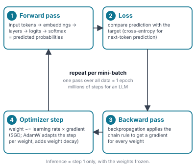

# Map 3 — Neural-network foundations

*The training loop and the architecture families.*

Every neural network, from a 10-line PyTorch example to a frontier LLM, is trained with the same four-step loop. The architecture decides what happens inside step 1; the data decides what the loss compares against.

## What you turn, what you watch

| | |
|---|---|
| **Knobs (hyperparameters)** | learning rate and its schedule · batch size · epochs / steps · model size (layers, width) · dropout · weight decay · LoRA rank · temperature (inference only) |
| **What you watch** | training loss going down · validation loss (if it rises while training loss keeps falling → overfitting) · gradient norm (spikes → lower the LR or clip) · perplexity · eval benchmarks |
| **What can go wrong** | overfitting · underfitting · vanishing or exploding gradients · loss spikes · catastrophic forgetting (fine-tuning) · reward hacking (RL) · data contamination (evals) |
| **Where the compute goes** | matrix multiplications in steps 1 and 3, run on GPUs in BF16 · memory is weights + gradients + optimizer state (≈ 16 bytes per parameter for full training with AdamW, ≈ 2 bytes for inference) |

## Architecture families (what goes inside step 1)

| Family | Mechanism | Used for |
|---|---|---|
| **MLP** | fully connected layers | tabular data; the FFN inside every Transformer block |
| **CNN** | sliding filters | images, audio spectrograms; ResNet, YOLO |
| **RNN / LSTM / GRU** | step-by-step memory | sequences before 2017; now mostly replaced |
| **Transformer** | attention over all tokens | LLMs, ViT, speech, protein folding |
| **Autoencoder / VAE** | compress → reconstruct | latent spaces, anomaly detection, image generation |
| **GAN** | generator vs discriminator | image generation 2014–2021, deepfakes |
| **Diffusion** | learn to remove noise | Stable Diffusion, DALL·E 2/3, video and audio generation |
| **MoE / SSM hybrids** | sparse experts, linear-time layers | cheaper large models; Mixtral, DeepSeek, Mamba |

## How we got here

| Year | Milestone | Why it mattered |
|---|---|---|
| 1958 | **Perceptron** | first trainable neuron |
| 1986 | **Backprop** | popularised; training deep nets becomes practical |
| 1997 | **LSTM** | recurrent nets that remember |
| 2012 | **AlexNet** | deep learning wins ImageNet; GPUs take over |
| 2013 | **word2vec** | word embeddings |
| 2014 | **GANs · seq2seq · attention** | generative models, attention invented for translation |
| 2017 | **Transformer** | "Attention Is All You Need" |
| 2018 | **GPT-1 · BERT** | pre-train then fine-tune becomes the recipe |
| 2020 | **GPT-3 · scaling laws** | in-context learning at 175B parameters |
| 2022 | **ChatGPT · RLHF · Chinchilla · Stable Diffusion** | post-training makes models usable |
| 2023 | **GPT-4 · Llama · QLoRA** | open weights; fine-tuning on one GPU |
| 2024 | **MoE goes mainstream · GRPO · o1 · MCP** | sparse models (Mixtral, Dec 2023), test-time compute, tool standards |
| 2025 | **DeepSeek-R1 · agents** | open reasoning models; agentic coding goes mainstream |
