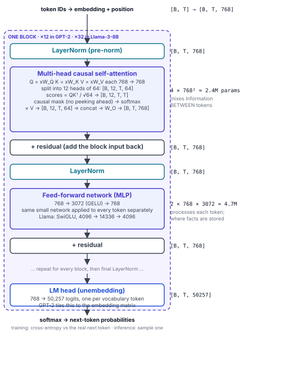

# Map 5 — Inside one Transformer block

*With the real numbers.*

Shapes are written as [B, T, d]: batch size, tokens in the sequence, vector width. GPT-2 small (124M) is the model Raschka builds in chapters 3–4; Llama-3-8B shows the same block with 2024 numbers. B = 1 and T = your prompt length at inference time.

## Two models, same block

| | GPT-2 small (2019) | Llama-3-8B (2024) |
|---|---|---|
| Vocabulary | 50,257 | 128,256 |
| Context length (trained) | 1,024 | 8,192 (3.1: 128k) |
| d_model (hidden size) | 768 | 4,096 |
| Attention heads | 12 × 64 | 32 × 128 (8 KV heads: GQA) |
| Layers (blocks) | 12 | 32 |
| FFN hidden size | 3,072 (GELU) | 14,336 (SwiGLU) |
| Normalization | LayerNorm | RMSNorm |
| Position | learned | RoPE |
| Parameters | 124M | 8.0B |
| Weights file (BF16) | 0.25 GB | 16 GB |

## Where GPT-2's 124M parameters are

Embeddings ≈ 32% · attention ≈ 23% · feed-forward ≈ 45%. Token embedding 50,257 × 768 = 38.6M (shared with the LM head) · positions 1,024 × 768 = 0.8M · per block: attention 2.4M + FFN 4.7M = 7.1M, × 12 = 85M. In bigger models the embeddings shrink to a few percent and the FFN dominates, which is why MoE replaces the FFN.

## Why the shapes matter

- **T appears squared** only in the attention scores [B, h, T, T]. That is the quadratic cost of long context, and what FlashAttention, GQA and the KV cache attack.
- **The FFN never looks at other tokens.** It is the same 768 → 3072 → 768 function applied to each position; attention is the only place tokens exchange information.
- **The residual stream** is the [B, T, 768] vector that each block adds to. The LM head reads it only at the end.
- **Parameter count ≈ 12 × n_layers × d_model²** for the blocks (+ embeddings). Double the width, four times the parameters.
